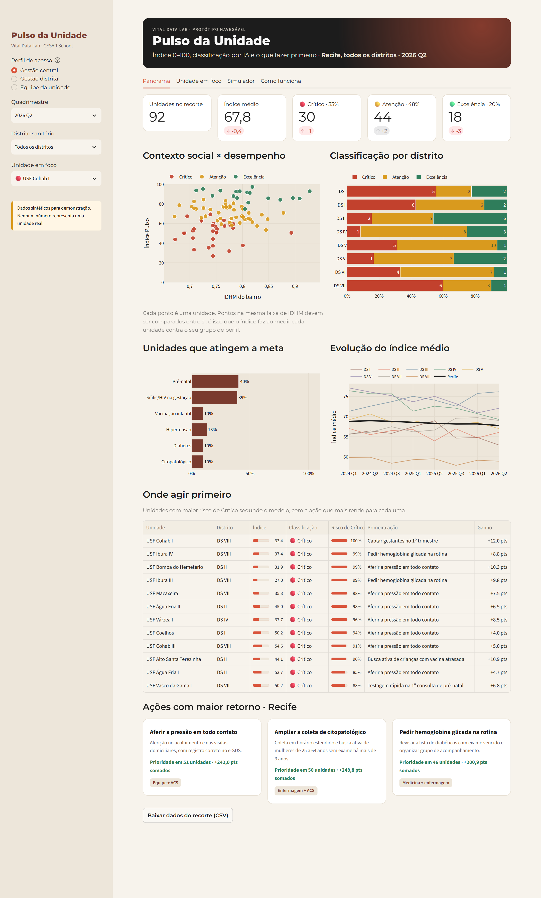
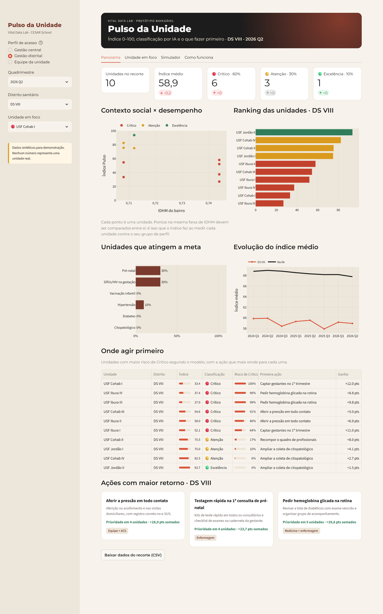
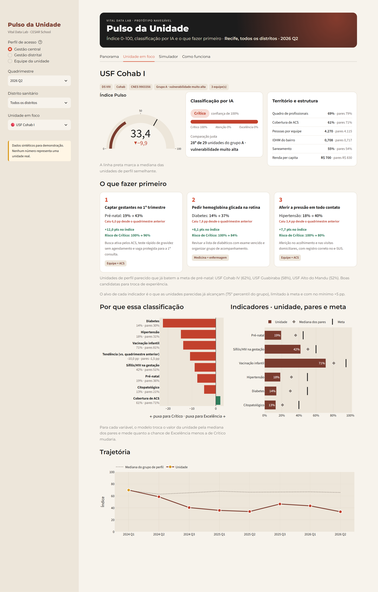
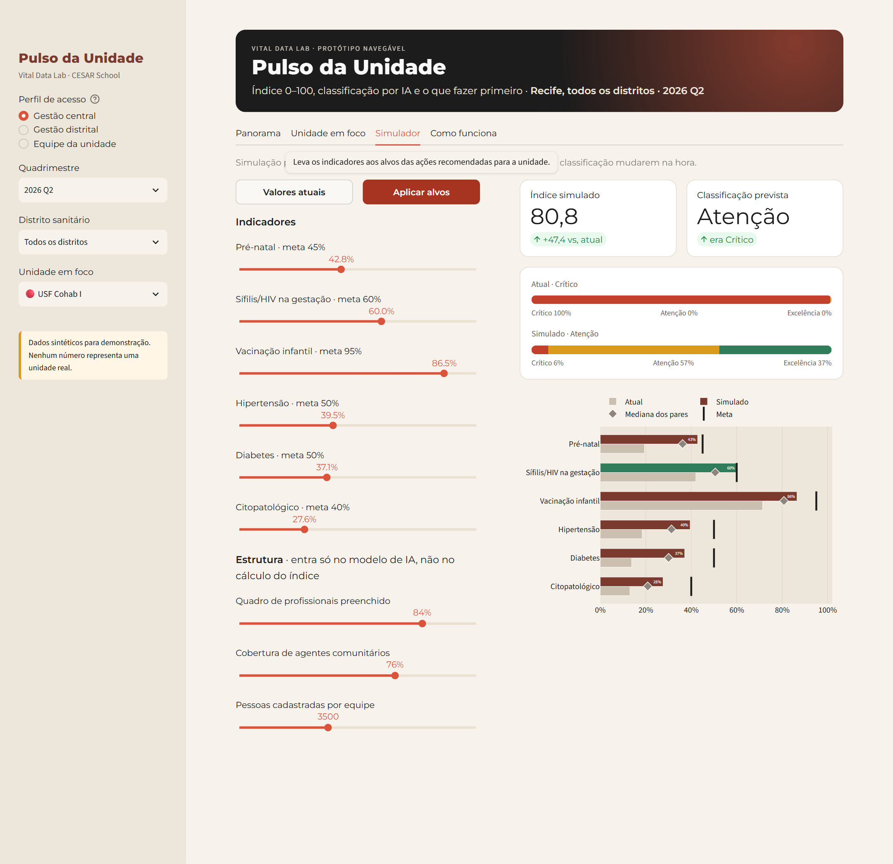
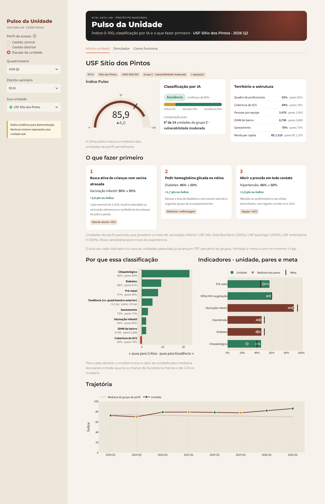
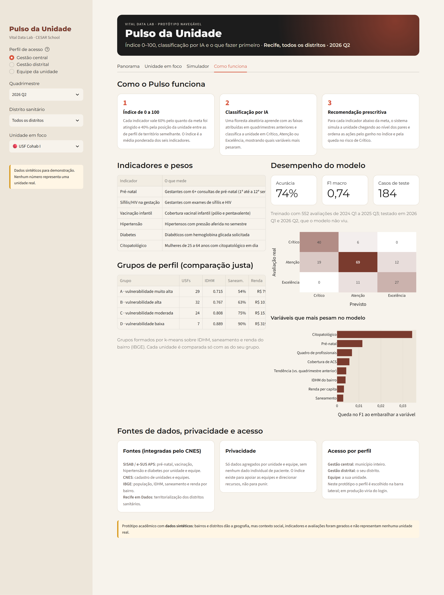

# Prints do protótipo Pulso da Unidade

Capturados em 10/10/2026 a partir do app rodando localmente. **Dados sintéticos**: os números não representam nenhuma unidade real.

O compilado em PDF está em [`pulso-da-unidade-prints.pdf`](pulso-da-unidade-prints.pdf).

## 1. Panorama · Gestão central

Visão do município: índice médio, classificação por distrito, contexto social × desempenho, metas atingidas, evolução no tempo e onde agir primeiro.

## 2. Panorama · Gestão distrital

O gestor distrital vê só as unidades do seu distrito, com o ranking e as ações de maior retorno.

## 3. Unidade em foco

Índice com a mediana dos pares, classificação por IA com probabilidades, as três ações prioritárias, os fatores da classificação, os indicadores e a trajetória.

## 4. Simulador

Com os alvos recomendados aplicados, o índice e a classificação são recalculados na hora.

## 5. Minha unidade · Equipe

No perfil de equipe, a tela mostra apenas a própria unidade.

## 6. Como funciona

Pesos dos indicadores, grupos de perfil, desempenho do modelo, fontes de dados, privacidade e acesso por perfil.

