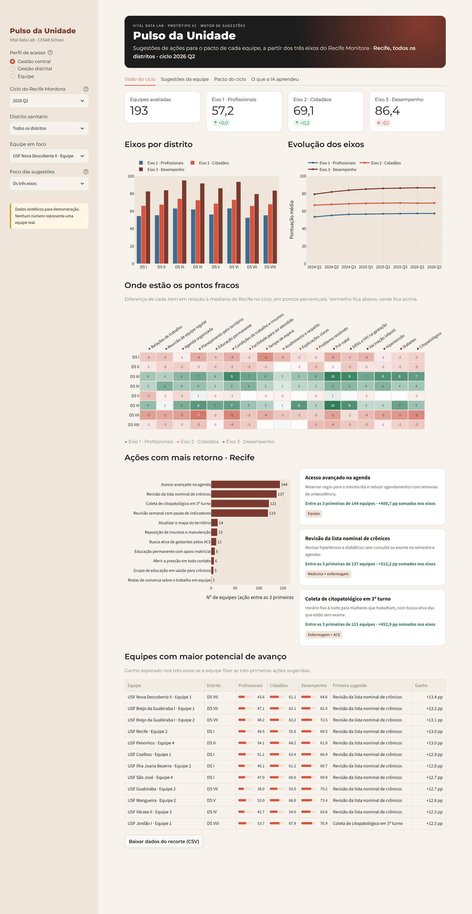
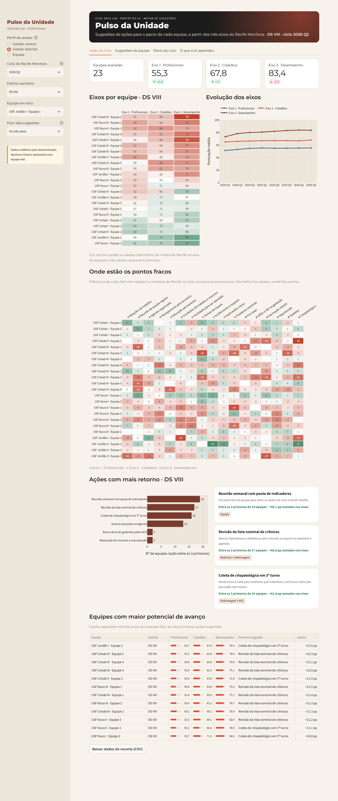
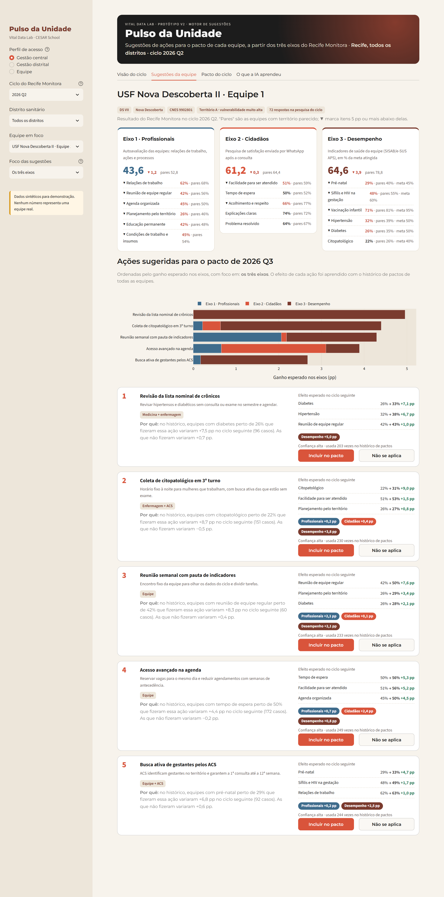
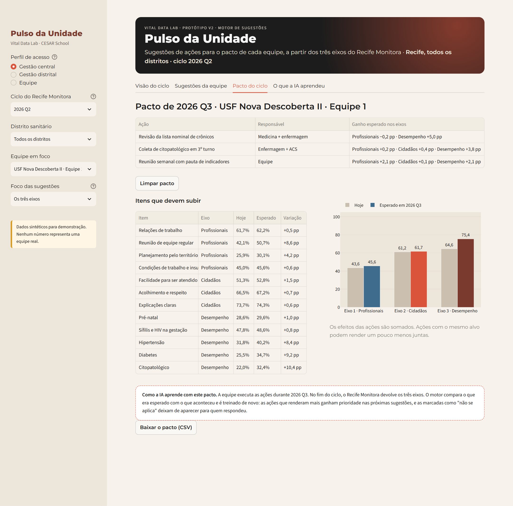
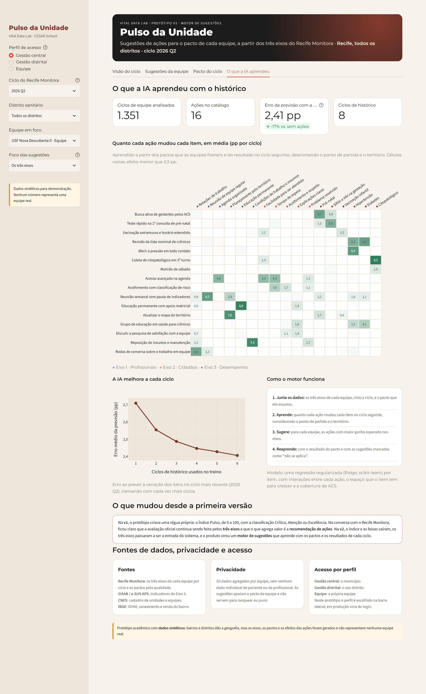

# Prints do protótipo · v2 (motor de sugestões)

Capturados em 15/10/2026 a partir do app rodando localmente. **Dados sintéticos**: os números não representam nenhuma equipe real.

**O que mudou desde a v1.** Na v1, o protótipo criava uma régua própria: o Índice Pulso, de 0 a 100, com a classificação Crítico, Atenção ou Excelência. Na conversa com o Recife Monitora, ficou claro que a avaliação oficial continua sendo feita pelos três eixos (profissionais, cidadãos e desempenho) e que o que agrega valor é a recomendação de ações. Na v2, o índice e as faixas saíram, os três eixos passaram a ser a entrada do sistema, e o produto virou um motor de sugestões que aprende com os pactos e os resultados de cada ciclo. Os prints da v1 estão em [`../v1`](../v1/README.md).

O compilado em PDF está em [`pulso-da-unidade-v2-prints.pdf`](pulso-da-unidade-v2-prints.pdf).

## 1. Visão do ciclo · Gestão central

Os três eixos do Recife Monitora por distrito e ao longo dos ciclos, os itens mais fracos de cada distrito, as ações com mais retorno e as equipes com maior potencial de avanço.

## 2. Visão do ciclo · Gestão distrital

O gestor distrital vê os eixos de cada equipe do seu distrito e onde estão os pontos fracos.

## 3. Sugestões da equipe

Resultado da equipe nos três eixos, comparado com equipes de território parecido, e as ações sugeridas para o próximo pacto, com o efeito esperado e a evidência do histórico.

## 4. Pacto do ciclo

As ações escolhidas para o pacto e a projeção dos três eixos no fim do ciclo. O resultado real volta para a IA, que é treinada de novo.

## 5. O que a IA aprendeu

Quanto cada ação mudou cada item no histórico, a melhora da IA a cada ciclo, como o motor funciona e o que mudou desde a v1.

## 6. Perfil de equipe · foco no Eixo 2

No perfil de equipe, só a própria equipe aparece. Com o foco no Eixo 2 (cidadãos), a ordem das sugestões muda na hora.

